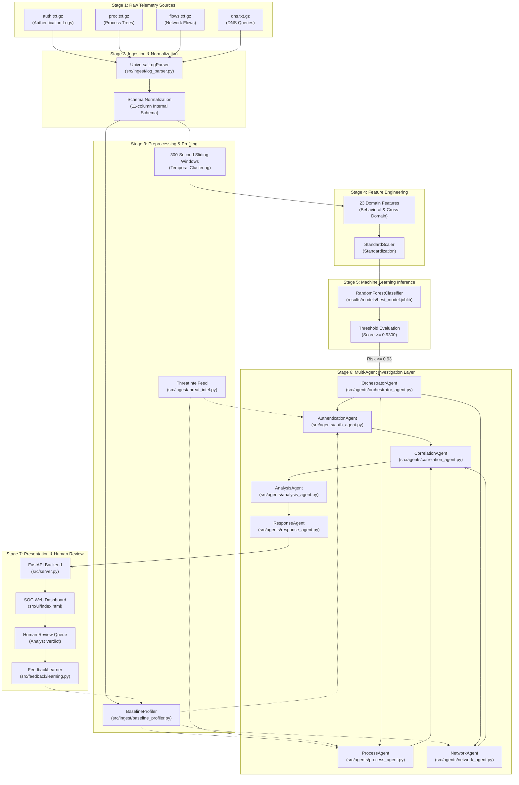

# AI Investigator: Project Overview and System Architecture

This document provides a comprehensive technical overview and architectural foundation for the **AI Investigator for Cybersecurity Threat Detection and Response** project. It is structured for viva defense, technical reviews, and in-depth engineering audits.

---

## 1. Problem Formulation and Motivation

Modern enterprise Security Operations Centers (SOCs) monitor massive streams of asynchronous, uncoordinated event telemetry across distributed endpoint authentication services, process execution logs, network routing gateways, and domain name resolvers. Defending large enterprise networks faces three fundamental challenges:

1. **Extreme Class Imbalance:** Normal business traffic constitutes over 99.6% of enterprise telemetry. Confirmed red-team adversary attacks account for less than 0.4% of events. Naive machine learning models collapse into majority-class classifiers, predicting everything as benign to achieve high accuracy while failing to detect intrusions.
2. **Multi-Source Log Fragmentation:** Sophisticated attack techniques (e.g., lateral movement, credential dumping, Pass-the-Hash) span multiple operational domains. An adversary authenticates via Kerberos or NTLM (`auth`), launches administrative command-line tools (`proc`), initiates network sweeps (`flows`), and communicates with external servers (`dns`). Siloed monitoring tools fail to connect these discrete events.
3. **SOC Alert Fatigue:** Traditional rule-based Security Information and Event Management (SIEM) engines fire thousands of disjoint alerts per shift, over 90% of which are benign false positives. High false alarm rates desensitize security analysts, leading to missed detections and prolonged adversary dwell times.

The AI Investigator solves these challenges by combining:
- Multi-source log ingestion and schema normalization.
- Temporal sliding window aggregation (300-second windows).
- 23-feature domain extraction capturing behavioral bursts and cross-domain interactions.
- A cost-sensitive Random Forest classifier trained with heavy penalty weighting on missed attacks.
- Specialized autonomous agents that reconstruct the investigative narrative.
- Governed advisory containment recommendations with strict human analyst sign-off.

---

## 2. Paradigm Comparison: Rule-Based vs. ML vs. Multi-Agent

| Attribute | Traditional Rule-Based SIEM | Standalone ML Detector | AI Investigator (ML + Multi-Agent) |
| :--- | :--- | :--- | :--- |
| **Detection Basis** | Static thresholds and known regex patterns (e.g., event ID 4625 > 5 in 60s). | Statistical anomalies or probability scores across numerical vectors. | Two-stage: Statistical ML probability + multi-agent contextual reasoning. |
| **Cross-Source Fusion** | Difficult; requires complex multi-join correlation rules. | Implicitly models feature correlations across windowed metrics. | Explicit domain agents (Auth, Process, Net) correlate findings via CorrelationAgent. |
| **Explainability** | High for single rules, but fails to explain multi-step attack progression. | "Black box" probability output; analysts cannot see why a window was flagged. | Generates structured investigative dossiers with MITRE ATT&CK tactic mappings. |
| **Class Imbalance** | Ignored; rules fire blindly regardless of background prevalence. | Severe vulnerability; prone to majority collapse without cost penalties. | Cost-sensitive Random Forest ({0: 1, 1: 10}) combined with threshold tuning. |
| **Response Action** | Blind automated scripts or passive unprioritized ticket queues. | Raw probability alerts requiring manual analyst investigation. | Staged advisory containment plans requiring human analyst sign-off. |

### Why Combine Machine Learning with Specialized Agents?
A single machine learning model produces a scalar probability score (e.g., `0.94`), but it cannot explain *what* happened, *which* entities are compromised, or *what* remediation actions should be taken. Conversely, rule-based systems struggle to detect novel attacks amidst background noise.

The AI Investigator bridges this gap:
1. **The ML Model acts as an Anomaly Filter:** It scans thousands of windows, suppressing benign background noise and elevating high-risk temporal clusters.
2. **The Specialized Agents act as Digital Investigators:** They dissect the flagged telemetry, analyzing authentication hops (`AuthAgent`), process execution trees (`ProcessAgent`), and network flows (`NetworkAgent`), synthesizing the evidence into an actionable investigation dossier (`ResponseAgent`).

---

## 3. End-to-End System Architecture

### Theoretical Complete Architecture Diagram (Mermaid)

---

## 4. Actual Implemented Architecture vs. Proposed Architecture

| Component | Implemented in Repository | Source Location | Status & Notes |
| :--- | :---: | :--- | :--- |
| **Multi-Source Log Ingestion** | Yes | `src/ingest/log_parser.py` | Implemented via `UniversalLogParser` supporting CSV, JSON, Syslog, CEF. |
| **Temporal Window Aggregation** | Yes | `src/model_optimization.py` | Implemented with 300-second non-overlapping sliding windows. |
| **23-Feature Domain Extraction** | Yes | `src/model_optimization.py` | Computes authentication, process, flow, DNS, and interaction metrics. |
| **Cost-Sensitive Random Forest** | Yes | `results/models/best_model.joblib` | 150 trees, max depth 10, class weight {0: 1, 1: 10}. |
| **High-Precision Alerting Mode** | Yes | `results/models/best_model.joblib` | Decision threshold frozen at 0.9300 to reduce false alarms. |
| **Specialist Domain Agents** | Yes | `src/agents/` | AuthAgent, ProcessAgent, NetworkAgent, CorrelationAgent, AnalysisAgent, ResponseAgent. |
| **Agent Orchestration** | Yes | `src/agents/orchestrator_agent.py` | Sequences data partitioning, specialist dispatch, and trace recording. |
| **Adaptive Baseline Profiler** | Yes | `src/ingest/baseline_profiler.py` | Builds user-host pairs, process counts, and velocity baselines without hardcoded IOCs. |
| **Threat Intelligence Feed** | Yes | `src/ingest/threat_intel.py` | Ingests external IOC lists (users, hosts, domains, processes) into contextual lookup sets. |
| **Analyst Feedback Learning Loop** | Yes | `src/feedback/learning.py` | Dynamically updates `watchlist.json` and `safelist.json` based on analyst review. |
| **FastAPI REST API & WebSocket** | Yes | `src/server.py` | Serves status, summary, simulation replay, file analysis, and incident inspection endpoints. |
| **Interactive SOC Web Dashboard** | Yes | `src/ui/index.html`, `app.js` | Tabbed dashboard with KPI cards, triage feed, agent inspector, and research results. |
| **Automated Active Containment** | *Advisory Only* | `src/agents/response_agent.py` | `requires_human_approval = True` enforced; containment is staged for human review. |
| **Autonomous Model Retraining** | *Proposed / Future Work* | `src/feedback/learning.py` | Feedback updates watchlists and safelists; models are not retrained in real time. |
| **Distributed Spark / Kafka Streaming** | *Proposed / Future Work* | Out of Scope | Current implementation processes files locally using pandas and Python standard libraries. |

---

## 5. Complete Project File Inventory

| Component / Subsystem | Actual File Path | Purpose | Input | Output |
| :--- | :--- | :--- | :--- | :--- |
| **Raw Telemetry Logs** | `data/raw/*.txt.gz` | Ground-truth benchmark logs from LANL Cyber-Security dataset | Los Alamos National Lab event stream | Raw compressed CSV text files |
| **Subset Data Extracts** | `data/subset/multisource_subset.csv` | Representative multi-source telemetry sample (Days 1–14) | Extracted from raw gzip logs | 11-column normalized event table |
| **Red Team Attack Records** | `data/raw/redteam.txt` | Ground-truth adversary lateral movement activity | LANL Red Team operational logs | Timestamped attack events (User, Source, Dest) |
| **Universal Log Parser** | `src/ingest/log_parser.py` | Ingests and normalizes multi-format logs | CSV, JSON, Syslog, CEF files | Standardized 11-column pandas DataFrame |
| **Adaptive Baseline Profiler** | `src/ingest/baseline_profiler.py` | Builds baseline entity distributions from data | Normalized event DataFrame | Context dictionary with adaptive thresholds |
| **Threat Intelligence Feed** | `src/ingest/threat_intel.py` | Manages known IOC indicators | CSV/JSON IOC feeds | Fast in-memory lookup sets (domains, hosts, users) |
| **Feature Engineering & ML** | `src/model_optimization.py` | Window aggregation, feature extraction, model fitting | Multi-source events DataFrame | 23-feature matrix, trained models, metrics |
| **Frozen ML Model Artifact** | `results/models/best_model.joblib` | Production model bundle with metadata | Serialized from `model_optimization.py` | Dict: model, scaler, features, threshold (0.9300) |
| **Authentication Specialist** | `src/agents/auth_agent.py` | Detects credential hopping, bursts, and NTLM anomalies | Normalized auth events + context | Flagged auth events, risk contribution, evidence |
| **Process Specialist** | `src/agents/process_agent.py` | Detects rare binary execution and LOLBins | Normalized process events + context | Flagged process events, risk contribution, evidence |
| **Network & DNS Specialist** | `src/agents/network_agent.py` | Detects flow volume spikes and DGA domain entropy | Normalized flow/DNS events + context | Flagged network events, risk contribution, evidence |
| **Cross-Source Correlation** | `src/agents/correlation_agent.py` | Clusters events into incidents across temporal window | Findings from domain specialists | Grouped incidents with entity graph linking |
| **Incident Analysis & Risk** | `src/agents/analysis_agent.py` | Calculates mathematically transparent Risk & Confidence | Grouped incidents from CorrelationAgent | Risk scores (0–100), Confidence (0–100), Severity |
| **Advisory Response Agent** | `src/agents/response_agent.py` | Maps to MITRE ATT&CK and stages containment plans | Analyzed incidents from AnalysisAgent | Recommended actions, investigation & containment steps |
| **Central Orchestrator** | `src/agents/orchestrator_agent.py` | Sequences pipeline execution and records audit trace | Telemetry DataFrame + context | Unified investigation dossier with execution trace |
| **Feedback Learning System** | `src/feedback/learning.py` | Records analyst decisions to watchlists/safelists | Incident review verdicts | `watchlist.json`, `safelist.json`, audit history |
| **FastAPI Backend Server** | `src/server.py` | Web service connecting models, agents, and UI | HTTP requests, file uploads, WebSocket | JSON REST responses, live event stream |
| **SOC Dashboard Interface** | `src/ui/index.html`, `app.js` | Interactive security analyst console | REST/WebSocket data from `server.py` | Visual SOC interface, triage queue, charts |
| **Presentation Preview** | `presentation_mockup/` | Standalone technical presentation suite | Illustrative scenario configuration | HTML preview, 17 figures (300 DPI), README |
| **Evaluation Records** | `results/reports/final_metrics.json` | Authoritative benchmark test evaluation records | Evaluated on held-out test windows | Test metrics, confusion matrix, threshold |
