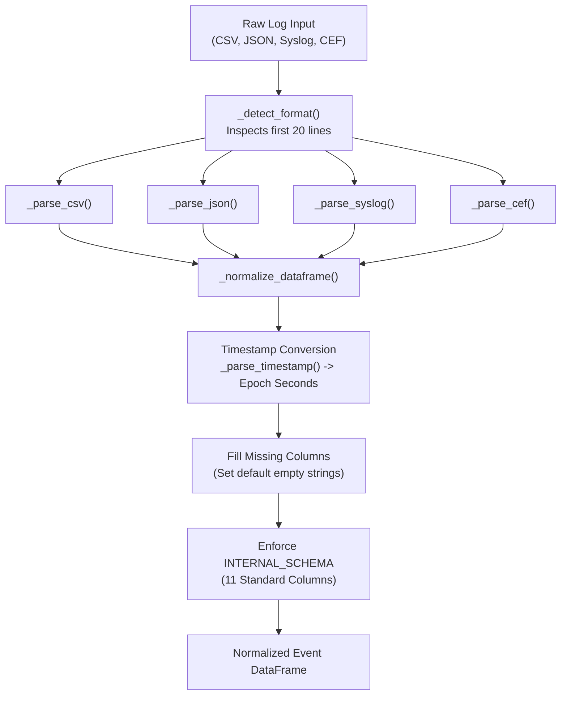

# AI Investigator: Data Ingestion and Preprocessing Pipeline

This document describes how raw telemetry from multiple enterprise formats is ingested, normalized, verified, and preprocessed into structured event frames and baseline profiles.

---

## 1. Universal Log Ingestion Engine (`UniversalLogParser`)

The ingestion layer is implemented in `src/ingest/log_parser.py` via the `UniversalLogParser` class. It decouples the AI Investigator from any single dataset format by accepting heterogeneous enterprise log formats:

1. **Standard CSV Files:** Autodetects delimiters (comma, tab, pipe, semicolon).
2. **JSON / JSONL Lines:** Parses structured event dictionaries and nested payloads.
3. **Syslog (RFC 3164):** Uses regular expressions (`_SYSLOG_PATTERN`) to extract priority, timestamp, hostname, process tag, and body.
4. **Common Event Format (CEF):** Decodes standard CEF headers and key-value extension pairs (`_CEF_PATTERN`).

### Dynamic Column Mapping (`_COLUMN_MAP`)
External logs rarely use uniform field names. `UniversalLogParser` contains a dynamic mapping dictionary that translates vendor-specific keys into the internal schema:

```python
# Excerpt from src/ingest/log_parser.py
_COLUMN_MAP = {
    # event_type mappings
    "event_type": "event_type", "type": "event_type", "category": "event_type",
    # timestamp mappings
    "timestamp": "timestamp", "time": "timestamp", "@timestamp": "timestamp", "ts": "timestamp",
    # user mappings
    "user": "user", "username": "user", "account": "user", "actor": "user",
    # source host mappings
    "source_host": "source_host", "src_ip": "source_host", "client_ip": "source_host", "workstation": "source_host",
    # destination host mappings
    "destination_host": "destination_host", "dst_ip": "destination_host", "target_host": "destination_host",
    # process mappings
    "process": "process", "image": "process", "command_line": "process", "cmdline": "process"
}
```

---

## 2. Ingestion Flow and Schema Normalization



### Parsing Operation Details:
1. **Format Detection:** Inspects initial bytes for JSON markers (`{` or `[`), CEF prefix (`CEF:0`), Syslog headers (`<PRI>Mon DD`), or tabular CSV separators.
2. **Timestamp Normalization:** Converts ISO-8601 strings (`2026-10-13T10:15:30Z`), standard Unix timestamps, or date-time strings into standard epoch seconds relative to UTC.
3. **Missing Value Sanitization:** Replaces nulls and NaN values with standard defaults (`""` for strings, `0` for numeric flags).

---

## 3. Adaptive Baseline Profiling (`BaselineProfiler`)

Located in `src/ingest/baseline_profiler.py`, the `BaselineProfiler` eliminates dependence on static, pre-labeled IOC lists by dynamically learning behavioral distributions directly from ingested telemetry:

```python
# Initialized in src/ingest/baseline_profiler.py
profiler = BaselineProfiler(
    auth_window_sec=300,
    rare_pair_percentile=5.0,
    rare_proc_percentile=5.0
)
context = profiler.build_context(df_events)
```

### Computed Behavioral Baselines:

1. **User-Host Pair Frequencies (`_build_user_host_pairs`):**
   - Counts occurrences of each `(user, host)` pair: `Counter((row.user, row.host))`.
   - Identifies the 5th percentile threshold (`rare_pair_threshold`). Any user authenticating to a host with occurrences below this threshold is flagged as an infrequent lateral authentication hop.

2. **Process Frequency Distribution (`_build_process_counts`):**
   - Counts historical execution frequency for every unique binary: `Counter(df[df.is_proc == 1]["process"])`.
   - Binaries appearing <= 5 times in training are marked in `rare_proc_set`.

3. **User Authentication Velocity (`_build_auth_velocity`):**
   - Partitions time into 300s windows and computes the distribution of authentication attempts per user.
   - Calculates the statistical mean (mean) and standard deviation (std).
   - Computes an adaptive burst threshold:
     ```
ext{Adaptive Burst Threshold = \mu + 2\sigma
```
   - Any activity exceeding this dynamically calculated threshold triggers a high-velocity warning.

4. **Host Network Flow Volumes (`_build_flow_volume`):**
   - Computes mean and standard deviation of bytes transferred per host.
   - Detects data exfiltration spikes where byte volume > mean_{	ext{bytes + 2std_{	ext{bytes.

5. **User Active Time Profiles (`_build_time_profile`):**
   - Builds a 24-bin histogram recording active hours per user: `(timestamp % 86400) // 3600`.
   - Identifies off-hours logons if the user authenticates during hours accounting for < 1.0\% of their baseline activity.

---

## 4. Threat Intelligence Integration (`ThreatIntelFeed`)

Located in `src/ingest/threat_intel.py`, `ThreatIntelFeed` manages external indicators of compromise (IOCs) ingested from threat feeds:

- **Indicator Types:** IP addresses, hostnames, usernames, file hashes, and domain names.
- **Lookup Performance:** Stored in native Python `set` collections providing O(1) constant-time lookup overhead during real-time event evaluation.
- **Context Injection:** When initialized, the feed merges known malicious indicators into the context dictionary passed to specialist agents.

---

## 5. Edge-Case Handling and Fault Tolerance

| Edge-Case Scenario | Implemented Code Behavior | Function / File | Proposed Improvement |
| :--- | :--- | :--- | :--- |
| **Missing Column** | Default empty string `""` or `0` assigned; pipeline does not crash. | `_normalize_dataframe()` in `log_parser.py` | Schema schema-validation error log emitted. |
| **Invalid Timestamp** | Falls back to current system time or `0`. | `_parse_timestamp()` in `log_parser.py` | Interpolate timestamp from adjacent events. |
| **Unseen Host / New User** | Frequency evaluated as `0`; flagged as First-Time Pair (R12). | `AuthenticationAgent.analyze()` in `auth_agent.py` | Cold-start entity warmup period. |
| **Zero Events in Window** | Empty DataFrame handled gracefully; returns empty finding list. | Guard clause `if df.empty:` in all agents | Emit heartbeat keep-alive message. |
| **Duplicate Event Records** | Deduplicated by unique `event_id` hash. | `CorrelationAgent.analyze()` in `correlation_agent.py` | Distributed bloom-filter deduplication. |
