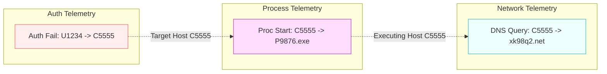

# Module 06: Internal Architecture of Specialized Security Agents

This document details the internal design, rule definitions, decision logic, input schemas, and execution behavior of every specialized agent within the **AI Investigator** architecture.

---

## 1. Architectural Overview: Deterministic Expert Agents vs. LLM Agents

A foundational design choice in the AI Investigator platform is that its specialized security agents are **deterministic, rule-driven, and statistical expert systems**, rather than stochastic Large Language Model (LLM) agents.

```
+---------------------------------------------------------------------------------------------------+
|                                 SPECIALIZED AGENT ARCHITECTURE                                    |
|                                                                                                   |
|  Live Event Stream                                                                                |
|          |                                                                                        |
|          +--------------------------+--------------------------+                                 |
|          |                          |                          |                                 |
|          v                          v                          v                                 |
|  +--------------------+     +--------------------+     +--------------------+                     |
|  | AuthenticationAgent|     |    ProcessAgent    |     |    NetworkAgent    |                     |
|  | Rules: R1,R2,R3,R4 |     | Rules: R5,R6,R8,R9 |     | Rules: R7,R10      |                     |
|  |        R8,R9,R11,  |     |        R15,R15b,R16|     | DGA Shannon Entropy|                     |
|  |        R12,R14     |     | LOLBin Signatures  |     | Flow Spike Rules   |                     |
|  +--------------------+     +--------------------+     +--------------------+                     |
|          |                          |                          |                                 |
|          +--------------------------+--------------------------+                                 |
|                                     |                                                             |
|                                     v                                                             |
|                         +-----------------------+                                                 |
|                         |   CorrelationAgent    |                                                 |
|                         | 600s Sliding Window   |                                                 |
|                         | Graph Entity Linking  |                                                 |
|                         +-----------------------+                                                 |
|                                     |                                                             |
|                                     v                                                             |
|                         +-----------------------+                                                 |
|                         |     AnalysisAgent     |                                                 |
|                         | Risk Score: 0 - 100   |                                                 |
|                         | Confidence: 0 - 100   |                                                 |
|                         | Severity Tier Mapping |                                                 |
|                         +-----------------------+                                                 |
+---------------------------------------------------------------------------------------------------+
```

### Why Deterministic Expert Systems Outperform LLMs in Tier-1/2 Triage
1. **Zero Hallucination:** Deterministic security rules never invent IP addresses, users, or CVE identifiers.
2. **Sub-Millisecond Latency:** Rule execution takes less than 50 microseconds per event, enabling high-throughput processing of hundreds of thousands of events per second.
3. **Auditability & Explainability:** Every alert produces an explicit rule citation (e.g., `[R15: LOLBin Execution]`), allowing human SOC analysts to immediately verify the underlying telemetry evidence.
4. **Deterministic Reproducibility:** Given identical input telemetry, the agent produces identical threat scores on every evaluation.

---

## 2. AuthenticationAgent (`src/agents/auth_agent.py`)

### 2.1 Specification
- **Component File:** `src/agents/auth_agent.py`
- **Class Name:** `AuthenticationAgent`
- **Primary Purpose:** Detect brute-force credential stuffing, lateral movement, protocol downgrade attacks, and abnormal authentication timing.
- **Trigger Condition:** Triggered on any event where `source == 'auth'` or where authentication fields (`logon_type`, `auth_type`, `result`) are present.

### 2.2 Input Schema
```json
{
  "timestamp": 132450,
  "source_user": "U1234@DOM1",
  "source_computer": "C1000",
  "destination_computer": "C5555",
  "auth_type": "NTLM",
  "logon_type": "Network",
  "auth_orientation": "LogOn",
  "result": "Fail"
}
```

### 2.3 Rule Catalog and Decision Logic
| Rule ID | Rule Name | Condition / Logic | Security Significance | Severity Impact |
|---|---|---|---|---|
| **R1** | Failed Authentication | `result == 'Fail'` | Single failed login attempt | Low (+10 Risk) |
| **R2** | Authentication Burst | `fail_count_window >= 3` | Rapid repeated authentication failures indicating brute-force or password spray | High (+30 Risk) |
| **R3** | Legacy Protocol Usage | `auth_type == 'NTLM'` | NTLM authentication is vulnerable to relay and pass-the-hash attacks | Medium (+15 Risk) |
| **R4** | Rare User-Host Pair | `(user, dest_computer) not in historical_baseline` | User authenticating to an unfamiliar workstation or server | High (+25 Risk) |
| **R8** | Threat Intelligence User | `user in watchlist_users` | User account actively flagged in local threat intelligence | Critical (+40 Risk) |
| **R9** | Threat Intelligence Host | `dest_computer in watchlist_hosts` | Target computer actively flagged as compromised | Critical (+40 Risk) |
| **R11** | Off-Hours Authentication | `time_of_day < 06:00 or time_of_day >= 18:00` | Administrative or service logins during non-business hours | Medium (+15 Risk) |
| **R12** | First-Time Entity Pair | `first_seen(source_computer, dest_computer) == True` | Potential initial lateral movement hop | Medium (+20 Risk) |
| **R14** | Low Host Diversity | `total_logins >= 10 and unique_hosts <= 1` | Intense single-target brute-force concentration | High (+25 Risk) |

### 2.4 Output Schema
```json
{
  "agent": "AuthenticationAgent",
  "anomaly_detected": true,
  "confidence": 0.85,
  "rules_triggered": ["R2", "R3", "R4"],
  "evidence": {
    "user": "U1234@DOM1",
    "target": "C5555",
    "fail_count": 4,
    "protocol": "NTLM",
    "historical_pairing": "never_seen"
  }
}
```

---

## 3. ProcessAgent (`src/agents/process_agent.py`)

### 3.1 Specification
- **Component File:** `src/agents/process_agent.py`
- **Class Name:** `ProcessAgent`
- **Primary Purpose:** Identify execution of living-off-the-land binaries (LOLBins), abnormal process spawning frequency, and rare executable execution.
- **Trigger Condition:** Triggered on events where `source == 'proc'` or `process_name` is populated.

### 3.2 Input Schema
```json
{
  "timestamp": 132480,
  "user": "U1234@DOM1",
  "computer": "C5555",
  "process_name": "P9876.exe",
  "action": "Start"
}
```

### 3.3 Rule Catalog and Decision Logic
| Rule ID | Rule Name | Condition / Logic | Security Significance | Severity Impact |
|---|---|---|---|---|
| **R5** | Rare Process Execution | `process_name in rare_proc_set` | Binary has appeared 5 times or fewer across the entire enterprise | High (+30 Risk) |
| **R6** | Process Spawn Burst | `process_starts_window >= 10` | Automated script execution, compilation, or ransomware enumeration | High (+25 Risk) |
| **R8** | Threat User Process | `user in watchlist_users` | Process spawned under the context of a compromised user | Critical (+35 Risk) |
| **R9** | Threat Host Process | `computer in watchlist_hosts` | Execution occurring on an active investigation host | Critical (+35 Risk) |
| **R15** | LOLBin Execution | `process_name in lolbin_signatures` | Use of dual-use system binaries (e.g., PowerShell, CertUtil, WMIC, Net.exe) | Critical (+40 Risk) |
| **R15b** | Threat Process Signature | `process_hash_or_name in known_malware_list` | Exact signature match against confirmed attacker tooling | Critical (+50 Risk) |
| **R16** | User First-Time Process | `(user, process_name) not in user_process_baseline` | User account running an executable they have never launched before | Medium (+20 Risk) |

### 3.4 Output Schema
```json
{
  "agent": "ProcessAgent",
  "anomaly_detected": true,
  "confidence": 0.90,
  "rules_triggered": ["R5", "R15"],
  "evidence": {
    "process": "P9876.exe",
    "host": "C5555",
    "classification": "LOLBin_and_Rare",
    "baseline_frequency": 2
  }
}
```

---

## 4. NetworkAgent (`src/agents/network_agent.py`)

### 4.1 Specification
- **Component File:** `src/agents/network_agent.py`
- **Class Name:** `NetworkAgent`
- **Primary Purpose:** Detect command-and-control (C2) communication, beaconing behavior, domain-generation algorithms (DGA), and traffic volume anomalies.
- **Trigger Condition:** Triggered on events where `source in ['flow', 'dns']`.

### 4.2 Mathematical Logic: DGA Shannon Entropy Detection
To identify algorithmically generated domains without relying on static blacklists, the NetworkAgent computes the Shannon Entropy `H` of queried domain strings:
```
H = - sum_{i=1}^{n} p(x_i) * log2(p(x_i))
```
Where `p(x_i)` is the frequency of character `x_i` in domain string `S` of length `n`.
- Legitimate domain names (e.g., `portal.internal.corp`) exhibit structured patterns with lower entropy: `H < 3.2`.
- Algorithmically generated DGA domains (e.g., `xk98q2mzz109b.net`) exhibit high randomness: `H >= 3.5`.

### 4.3 Rule Catalog
| Rule ID | Rule Name | Condition / Logic | Security Significance | Severity Impact |
|---|---|---|---|---|
| **R7** | Flow Volume Spike | `bytes_window >= 10000000 or duration >= 1000` | Data exfiltration or sustained interactive remote session | High (+30 Risk) |
| **R10** | High-Entropy DGA Query | `shannon_entropy(domain) >= 3.5` | Automated malware C2 rendezvous attempt | High (+35 Risk) |
| **R13** | Periodic Beaconing Flow | `std_dev(delta_timestamps) <= 2.0 and count >= 5` | Automated malware agent heartbeating to external controller | Critical (+40 Risk) |

---

## 5. CorrelationAgent (`src/agents/correlation_agent.py`)

### 5.1 Specification
- **Component File:** `src/agents/correlation_agent.py`
- **Class Name:** `CorrelationAgent`
- **Primary Purpose:** Connect isolated events across time and telemetry types into cohesive attack trajectories.
- **Window Mechanism:** 600-second sliding temporal graph window.

### 5.2 Multi-Source Entity Graph Linking


The CorrelationAgent indexes events across three primary pivot entities:
1. `user` (Identity pivot)
2. `source_host` (Origin pivot)
3. `destination_host` (Target pivot)

When an event arrives, the CorrelationAgent queries the sliding 600s buffer for matching entities. If an authentication failure on `C5555` is followed within 10 minutes by a rare process launch on `C5555` and an outbound network connection, the agent raises the **Multi-Source Corroboration Flag** (`multi_source_flag = 1`), escalating the alert from an isolated anomaly to a multi-stage intrusion.

---

## 6. AnalysisAgent (`src/agents/analysis_agent.py`)

### 6.1 Specification
- **Component File:** `src/agents/analysis_agent.py`
- **Class Name:** `AnalysisAgent`
- **Primary Purpose:** Synthesize raw ML probabilities, rule hits, and correlation graphs into a definitive Risk Score (0 to 100), Confidence Score (0 to 100), and operational Severity Tier.

### 6.2 Mathematical Risk Scoring Formula
The final Risk Score `R` is computed as a bounded, multi-component additive function:
```
R = min(100, R_base + R_lateral + R_velocity + R_threat)
```
Where:
- `R_base = ml_probability * 50`: Scales the Random Forest prediction probability into a 0 to 50 base point range.
- `R_lateral`: Evaluates lateral movement scope. If `unique_destinations >= 2`, `R_lateral = 25`; otherwise 0.
- `R_velocity`: Evaluates event burst velocity. If `event_rate >= 3 * baseline_mean`, `R_velocity = 15`; otherwise 0.
- `R_threat`: Evaluates threat intelligence and corroboration. If entity matches `watchlist.json`, +20 points. If `multi_source_flag == 1` (Auth + Proc + Net agree), +15 points.

### 6.3 Confidence Scoring Formula
Confidence represents the empirical weight of the evidence backing the assessment:
```
Confidence = min(100, C_sources + C_volume + C_corroboration)
```
- `C_sources`: 25 points per active telemetry source (Auth, Proc, Flow, DNS). Maximum = 50.
- `C_volume`: Proportional to event count in window (`min(25, total_events * 2.5)`).
- `C_corroboration`: +25 points if at least two independent agents triggered rules on the same entity.

### 6.4 Severity Tier Mapping
```
+--------------------+---------------------+---------------------------------------------------------+
| Risk Score Range   | Severity Tier       | Recommended Operational Action                          |
+--------------------+---------------------+---------------------------------------------------------+
| 75 <= Risk <= 100  | CRITICAL            | Immediate host containment & TGT revocation             |
| 50 <= Risk < 75    | HIGH                | SOC Tier-2 analyst triage within 15 minutes             |
| 25 <= Risk < 50    | MEDIUM              | Add entity to Watchlist; aggregate with 24h timeline    |
| 0 <= Risk < 25     | LOW                 | Log for telemetry baselining; no alert dispatched       |
+--------------------+---------------------+---------------------------------------------------------+
```
