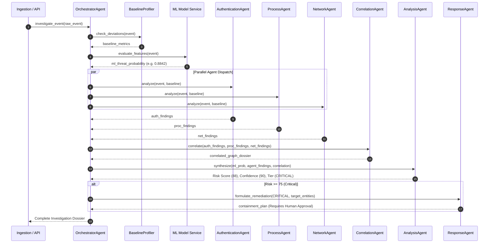

# Module 07: Orchestrator Engine, Routing Logic, and Scoring Mathematics

This document details the central control flow of the **AI Investigator** architecture, focusing on the `OrchestratorAgent`, dynamic agent dispatch, conflict resolution, and the mathematical formulas governing unified risk scoring.

---

## 1. Orchestrator Control Flow Architecture

The `OrchestratorAgent` (`src/orchestrator.py`) serves as the central brain of the multi-agent system. It manages the lifecycle of an investigation from initial event ingestion to final response dispatch.



---

## 2. Dynamic Agent Dispatch Logic

The orchestrator dynamically routes incoming events based on telemetry type and suspicious indicator thresholds:

```python
# Simplified Representation of Orchestrator Dispatch in src/orchestrator.py
def route_event(self, event, ml_prob):
    findings = []
    
    # 1. Dispatch based on telemetry source
    if event.get("source") == "auth" or "logon_type" in event:
        findings.append(self.auth_agent.evaluate(event))
        
    if event.get("source") == "proc" or "process_name" in event:
        findings.append(self.process_agent.evaluate(event))
        
    if event.get("source") in ["flow", "dns"] or "dest_port" in event:
        findings.append(self.network_agent.evaluate(event))
        
    # 2. Contextual Secondary Dispatch: If ML model indicates high suspicion
    # but event is an auth log, proactively query process history for destination host
    if ml_prob >= 0.70 and "destination_computer" in event:
        dest_host = event["destination_computer"]
        recent_procs = self.history_buffer.get_recent_processes(dest_host, window_sec=300)
        if recent_procs:
            findings.append(self.process_agent.evaluate_batch(recent_procs))
            
    return findings
```

### Dispatch Rules
1. **Primary Telemetry Mapping:** Each event is routed immediately to its primary domain agent (Authentication, Process, or Network).
2. **Predictive Escalation Trigger:** If the machine learning model produces a threat probability `P(malicious) >= 0.70`, the orchestrator automatically triggers cross-telemetry inspection. For example, if an authentication event flags high probability, the orchestrator pulls recent process executions from the target host buffer to inspect for immediate post-exploitation activity.
3. **Correlation Aggregation:** Regardless of individual agent outcomes, all active findings within the current 600-second window are passed to the `CorrelationAgent` to detect multi-stage attack chains.

---

## 3. Conflict Resolution Between ML and Heuristic Agents

A fundamental challenge in multi-agent cybersecurity systems is handling conflicting evidence. Two primary conflict scenarios occur:

```
+---------------------------------------------------------------------------------------------------+
|                                     EVIDENCE CONFLICT MATRIX                                      |
|                                                                                                   |
|  Scenario A: High ML Probability (0.91) BUT Zero Agent Rules Triggered                           |
|  Reason: Novel attack pattern or subtle anomaly captured by high-dimensional tree splits.          |
|  Resolution: AnalysisAgent marks Risk = 50 (HIGH), flags "Unexplained Statistical Anomaly",       |
|              and dispatches Tier-2 human investigation without executing automated containment.    |
|                                                                                                   |
|  Scenario B: Low ML Probability (0.12) BUT Agent Rule R15 (LOLBin) Triggered                      |
|  Reason: Attack executed using low event volume and standard business hours (mimicking benign).   |
|  Resolution: Deterministic security rules OVERRIDE the ML probability. R15 injects +40 points.    |
|              Final Risk = min(100, 6 + 40 + ...) = 56 (HIGH). Alert is dispatched.                |
+---------------------------------------------------------------------------------------------------+
```

### Safety Policy
- **Deterministic Rules Act as Safety Guards:** A high-confidence rule match (such as a known malicious tool or confirmed living-off-the-land binary) will **always override** a low ML probability. The model cannot silence a verified signature rule.
- **ML Functions as an Early Anomaly Sensor:** High ML probability without specific rule matches elevates the investigation priority to ensure novel zero-day behaviors receive human analyst review.

---

## 4. Mathematical Risk Scoring and Calibration

The `AnalysisAgent` produces three distinct metrics: **ML Threat Probability**, **Risk Score**, and **Confidence Score**. These metrics serve complementary operational purposes:

| Metric | Mathematical Range | Calculation Basis | Operational Interpretation |
|---|---|---|---|
| **ML Probability** | 0.0000 to 1.0000 | Random Forest ensemble vote fraction | Statistical likelihood that feature vector matches red-team profiles |
| **Combined Risk Score** | 0 to 100 | Multi-factor additive formula combining ML, rules, and lateral scope | Estimated severity of damage to the organization |
| **Confidence Score** | 0 to 100 | Volume, diversity, and agreement of observed telemetry sources | Reliability of the evidence supporting the risk score |

### Full Formula Breakdown
```
R = min(100, R_base + R_lateral + R_velocity + R_threat)
```
1. `R_base = ml_probability * 50`: Base score scaled from 0 to 50.
2. `R_lateral`:
```
R_lateral = 25   if (unique_destination_hosts >= 2)
R_lateral = 0    otherwise
```
3. `R_velocity`:
```
R_velocity = 15  if (window_event_count >= 3 * baseline_mean_volume)
R_velocity = 0   otherwise
```
4. `R_threat`:
```
R_threat = min(25, (watchlist_matches * 20) + (multi_source_flag * 15))
```

### Concrete Numerical Walkthrough
Consider a scenario with the following measurements:
- Random Forest probability: `P = 0.8842` -> `R_base = 0.8842 * 50 = 44.21`
- Target hosts: Attacker logged into `C5555` and `C9999` -> `unique_destinations = 2` -> `R_lateral = 25`
- Event volume: Normal traffic rate -> `R_velocity = 0`
- Threat Intel: Target `C5555` is on `watchlist.json` (+20); both Auth and Process agents triggered (+15) -> `R_threat = min(25, 20 + 15) = 25`

**Final Risk Score:**
```
R = min(100, 44.21 + 25 + 0 + 25) = min(100, 94.21) = 94.21 (CRITICAL)
```
