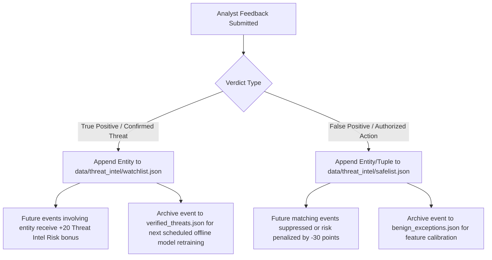

# Module 08: Incident Response, Human-in-the-Loop Review, and Adaptive Feedback

This document details the operational response workflow, containment actions, human authorization requirements, and adaptive feedback learning loops in the **AI Investigator** architecture.

---

## 1. Response Philosophy: Autonomous Staging vs. Supervised Execution

In enterprise Security Operations Centers (SOCs), unconstrained autonomous containment can inadvertently cause severe operational disruptions—such as taking a critical domain controller offline due to a false-positive detection.

```
+---------------------------------------------------------------------------------------------------+
|                                INCIDENT RESPONSE & FEEDBACK LOOP                                  |
|                                                                                                   |
|  AnalysisAgent flags Incident: Severity == CRITICAL, Risk Score == 94                             |
|          |                                                                                        |
|          v                                                                                        |
|  ResponseAgent Formulates Remediation Plan (src/agents/response_agent.py)                         |
|  - Passive Actions (Automatic): ADD_TO_WATCHLIST, INCREASE_LOGGING_VERBOSITY                      |
|  - Active Actions (Gated):      ISOLATE_HOST, REVOKE_KERBEROS_TGT, KILL_PROCESS_TREE              |
|          |                                                                                        |
|          v                                                                                        |
|  Human-in-the-Loop Review Interface (SOC Analyst Dashboard)                                       |
|  Analyst inspects Evidence Dossier -> Clicks [APPROVE] or [REJECT]                                |
|          |                                                                                        |
|          +------------------------------------+-----------------------------------+              |
|          | APPROVED (True Positive)           | REJECTED (False Positive)         |              |
|          v                                    v                                   |              |
|  Execute Active Containment Actions           Suppress Active Containment Actions |              |
|  Log Action to Audit Trail                    Log Dismissal to Audit Trail        |              |
|          |                                    |                                   |              |
|          v                                    v                                   |              |
|  FeedbackLearner (src/feedback/learning.py)   FeedbackLearner                     |              |
|  Append Entity to watchlist.json              Append Entity to safelist.json      |              |
|  Escalate Future Priority on Host             Suppress Future Low-Severity Alerts |              |
+---------------------------------------------------------------------------------------------------+
```

### Core Response Principle
**Destructive or disruptive actions always require human analyst authorization (`requires_human_approval = True`). Passive monitoring and threat-intelligence staging execute automatically.**

---

## 2. Action Catalog and MITRE ATT&CK Mapping

The `ResponseAgent` (`src/agents/response_agent.py`) maps detected adversary techniques to specific containment actions:

| Action Identifier | Action Name | MITRE ATT&CK Target | Operational Mechanism | Authorization Mode |
|---|---|---|---|---|
| `ISOLATE_HOST` | Host Network Isolation | T1021 (Remote Services), T1071 (C2) | Modifies host firewall rules to sever all inbound/outbound IP traffic except SOC management port 5985/SSH | **Requires Human Approval** |
| `REVOKE_KERBEROS_TGT` | Revoke User Session | T1078 (Valid Accounts), T1558 (Kerberoasting) | Invalidates user Kerberos Ticket Granting Ticket in Active Directory; forces immediate credential re-prompt | **Requires Human Approval** |
| `KILL_PROCESS_TREE` | Terminate Process Tree | T1059 (Command & Scripting), T1055 (Injection) | Sends `SIGKILL` / `TerminateProcess` to malicious parent process ID and all spawned child processes | **Requires Human Approval** |
| `ADD_TO_WATCHLIST` | Escalate Threat Intelligence | T1087 (Account Discovery) | Appends user or computer identifier to `data/threat_intel/watchlist.json` | **Fully Automatic** |
| `INCREASE_LOGGING` | Dynamic Telemetry Verbosity | T1562 (Impair Defenses) | Reconfigures local audit policy on target host to record full command-line arguments and script blocks | **Fully Automatic** |

---

## 3. Human-in-the-Loop Review Workflow

When an investigation reaches `Critical` or `High` severity, the system packages the findings into a standardized **Incident Dossier** presented on the Analyst Dashboard (`results/reports/investigation_dashboard.html` or API endpoint `/api/feedback`):

```json
{
  "incident_id": "INC-20261014-001",
  "timestamp": 132480,
  "risk_score": 94,
  "confidence": 90,
  "severity": "CRITICAL",
  "target_user": "U1234@DOM1",
  "target_host": "C5555",
  "primary_rules": ["R2: Auth Burst", "R4: Rare Pair", "R15: LOLBin Execution"],
  "ml_probability": 0.8842,
  "proposed_actions": [
    {
      "action": "ISOLATE_HOST",
      "target": "C5555",
      "status": "AWAITING_APPROVAL"
    },
    {
      "action": "REVOKE_KERBEROS_TGT",
      "target": "U1234@DOM1",
      "status": "AWAITING_APPROVAL"
    }
  ]
}
```

The SOC analyst evaluates the context:
1. If the activity is confirmed malicious (e.g., unauthorized administrative execution), the analyst clicks **Approve Remediation**. The orchestrator immediately dispatches containment commands and logs the audit event.
2. If the activity is verified as authorized administrative maintenance (e.g., an approved vulnerability scanner or IT script), the analyst clicks **Dismiss / False Positive**. Containment is canceled, and the audit log records the analyst justification.

---

## 4. Adaptive Feedback Learning (`src/feedback/learning.py`)

A critical distinction in enterprise AI is how feedback is assimilated.

### Axiom on Continuous Learning
**Analyst feedback does NOT immediately trigger gradient updates or retrain the Random Forest model. Live retraining is dangerous because single-sample updates can degrade decision boundaries and invite adversarial poisoning. Instead, feedback updates local state lists (`watchlist.json` and `safelist.json`) to adjust threat-intelligence heuristics immediately.**

### Feedback Assimilation Mechanisms


1. **True Positive Pipeline:**
   - Entity (e.g., `U1234@DOM1`) added to `watchlist.json`.
   - Subsequent events involving `U1234@DOM1` automatically trigger Rule R8 in the Authentication and Process agents, adding +20 to +40 risk points.
   - The labeled sample is stored in `results/feedback/training_staging.json` to be incorporated during the next scheduled quarterly model retraining cycle.
2. **False Positive Pipeline:**
   - Entity-action tuple (e.g., `("U1234@DOM1", "C5555", "P9876.exe")`) added to `safelist.json`.
   - In subsequent inference cycles, the `AnalysisAgent` checks incoming records against `safelist.json`. If a match is found, the system suppresses the alert or subtracts 30 risk points, preventing recurring false alarms for scheduled maintenance scripts.
