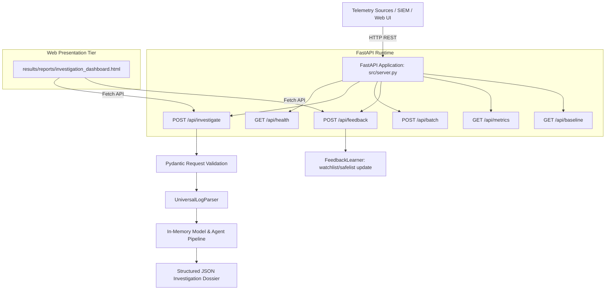

# Module 09: FastAPI Server, Endpoints, and SOC Dashboard Architecture

This document details the API server architecture, Pydantic request/response schemas, endpoint definitions, error handling, and web dashboard integration in the **AI Investigator** platform.

---

## 1. API Architecture Overview

The backend API server (`src/server.py`) is built using **FastAPI** and served via **Uvicorn**. It exposes high-performance asynchronous REST endpoints enabling SIEM forwarders, endpoint telemetry agents, and human analyst dashboards to submit events and retrieve structured investigation dossiers.



---

## 2. API Endpoints Catalog

### 2.1 Health and Readiness: `GET /api/health`
- **Method:** `GET`
- **Path:** `/api/health`
- **Purpose:** Verifies that the server is operational, the serialized machine learning model `best_model.joblib` is loaded in memory, and the multi-agent mesh is initialized.
- **Response Schema:**
```json
{
  "status": "healthy",
  "model_loaded": true,
  "scaler_loaded": true,
  "agent_mesh_active": true,
  "timestamp": 1728892400
}
```

### 2.2 Single Event Investigation: `POST /api/investigate`
- **Method:** `POST`
- **Path:** `/api/investigate`
- **Purpose:** Receives a single raw or structured telemetry event, normalizes it, extracts features, performs model inference, dispatches agents, and returns a unified investigation dossier.
- **Request Body (Pydantic Schema):**
```json
{
  "timestamp": 132480,
  "source": "auth",
  "source_user": "U1234@DOM1",
  "source_computer": "C1000",
  "destination_computer": "C5555",
  "auth_type": "NTLM",
  "logon_type": "Network",
  "auth_orientation": "LogOn",
  "result": "Fail"
}
```
- **Response Body (200 OK):**
```json
{
  "investigation_id": "INV-1728892400-001",
  "timestamp": 132480,
  "ml_threat_probability": 0.8842,
  "risk_score": 88,
  "confidence_score": 90,
  "severity": "CRITICAL",
  "primary_entities": {
    "user": "U1234@DOM1",
    "source_host": "C1000",
    "destination_host": "C5555"
  },
  "triggered_rules": [
    {"rule_id": "R2", "agent": "AuthenticationAgent", "description": "Authentication burst: >=3 failures in window"},
    {"rule_id": "R3", "agent": "AuthenticationAgent", "description": "Legacy NTLM authentication protocol usage"},
    {"rule_id": "R4", "agent": "AuthenticationAgent", "description": "Rare user-host pairing not in baseline"}
  ],
  "correlation": {
    "multi_source_corroborated": true,
    "active_sources": ["auth", "proc"]
  },
  "recommended_actions": [
    {"action": "ISOLATE_HOST", "target": "C5555", "requires_approval": true},
    {"action": "REVOKE_KERBEROS_TGT", "target": "U1234@DOM1", "requires_approval": true},
    {"action": "ADD_TO_WATCHLIST", "target": "U1234@DOM1", "requires_approval": false}
  ]
}
```

### 2.3 Batch Event Investigation: `POST /api/batch`
- **Method:** `POST`
- **Path:** `/api/batch`
- **Purpose:** Ingests an array of telemetry events (up to 1,000 records per request) for high-throughput batch evaluation.
- **Request Body:** JSON array containing event objects conforming to the single event schema.

### 2.4 Analyst Feedback Submission: `POST /api/feedback`
- **Method:** `POST`
- **Path:** `/api/feedback`
- **Purpose:** Captures human analyst review decisions (True Positive vs. False Positive) and triggers state list updates.
- **Request Body:**
```json
{
  "investigation_id": "INV-1728892400-001",
  "analyst_id": "ANALYST_04",
  "verdict": "TRUE_POSITIVE",
  "action_approved": true,
  "target_entity": "U1234@DOM1",
  "comments": "Confirmed unauthorized lateral movement attempt using compromised credentials."
}
```
- **Response Body:**
```json
{
  "status": "feedback_recorded",
  "entity_updated": "U1234@DOM1",
  "target_state": "watchlist.json",
  "audit_logged": true
}
```

---

## 3. Web Dashboard Integration (`results/reports/investigation_dashboard.html`)

The system provides a responsive, standalone HTML5/CSS3 Security Operations Center (SOC) dashboard.

### 3.1 Dashboard Architecture
- **Pure Client-Side Implementation:** Built with Vanilla HTML5, CSS Grid/Flexbox, and modern JavaScript. Requires no external Node.js dependencies, ensuring ease of deployment in air-gapped security environments.
- **Dynamic Asynchronous Polling:** Queries `/api/investigate` and `/api/metrics` using the browser's native `fetch()` API.
- **Visual Alert Priority Queue:** Color-coded severity tiers:
  - **CRITICAL (Red #ef4444):** Demands immediate Tier-3 analyst attention.
  - **HIGH (Orange #f97316):** Assigned to Tier-2 analysts for active investigation.
  - **MEDIUM (Amber #f59e0b):** Logged with entity watchlist aggregation.
  - **LOW (Emerald #10b981):** Informational; suppressed from audible alerts.

### 3.2 Human Authorization Modal
When an incident includes proposed destructive actions (`ISOLATE_HOST`, `REVOKE_KERBEROS_TGT`), the dashboard displays a prominent authorization modal:
- Renders the full telemetry timeline and triggered rule evidence.
- Provides two interactive controls:
  - **[Approve Containment]:** Sends a POST request to `/api/feedback` with `action_approved: true`, triggering immediate host isolation.
  - **[Mark as False Positive]:** Sends a POST request to `/api/feedback` with `verdict: FALSE_POSITIVE`, releasing the host and adding the pattern to `safelist.json`.
