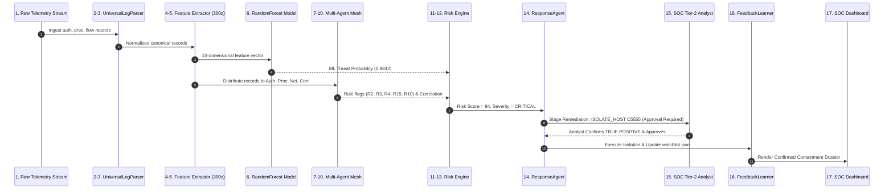

# Module 10: Complete End-to-End Incident Walkthrough: Multi-Stage Lateral Movement

This document provides a comprehensive, numbered 17-step walkthrough of a realistic enterprise cyber attack, tracing the incident from the arrival of the raw log record to automated response staging, human authorization, and adaptive feedback learning.

---

## 1. Incident Scenario: Lateral Movement and Data Staging

- **Adversary Profile:** Advanced Persistent Threat (APT) utilizing compromised internal credentials.
- **Target Assets:** Origin host `C1000` -> Target workstation `C5555` -> Critical Domain Controller `C500`.
- **Attack Progression:**
  1. Brute-force credential stuffing / NTLM pass-the-hash authentication against `C5555`.
  2. Execution of a living-off-the-land utility (`P9876.exe` / `powershell.exe`) on `C5555`.
  3. High-entropy DNS beaconing and data staging flow to external infrastructure.

---

## 2. Numbered 17-Step Execution Trace



### Step 1: Raw Log Arrival
Telemetry arrives from endpoint `C1000`:
```text
132450,U1234@DOM1,C1000,C5555,NTLM,Network,LogOn,Fail
132452,U1234@DOM1,C1000,C5555,NTLM,Network,LogOn,Fail
132455,U1234@DOM1,C1000,C5555,NTLM,Network,LogOn,Fail
132458,U1234@DOM1,C1000,C5555,NTLM,Network,LogOn,Success
```

### Step 2: Ingestion and Format Parsing
`UniversalLogParser` parses the comma-separated tokens, strips domain prefixes, and formats fields into the canonical internal dictionary.

### Step 3: Data Validation and Normalization
Schema validation confirms all mandatory fields exist. The timestamp `132450` is validated as valid epoch time within the active enterprise telemetry range.

### Step 4: Time-Window Assignment
The event timestamp `132450` is mapped into its non-overlapping 300-second window bucket:
```
Window ID = floor((132450 - 130000) / 300) = floor(2450 / 300) = 8
```

### Step 5: Feature Engineering
The feature engine aggregates window events into the 23 model features:
- `total_events = 4`
- `is_auth = 1.0`
- `auth_fail = 3.0`
- `auth_fail_rate = 3 / 4 = 0.75`
- `auth_ntlm = 4.0`
- `auth_ntlm_rate = 4 / 4 = 1.00`
- `user_to_host_ratio = 1 / 2 = 0.50`
- `delta_auth_fails = +3.0`

### Step 6: Machine Learning Model Inference
The 23-element vector is passed through `StandardScaler` and into `best_model.joblib`:
```python
ml_prob = model.predict_proba(X_scaled)[0, 1]  # Returns 0.8842
```
The tree ensemble outputs an 88.42% likelihood of malicious activity.

### Step 7: Authentication Agent Evaluation
`AuthenticationAgent` evaluates the event sequence against its rule catalog:
- **Rule R1 Triggered:** Single failed login attempt.
- **Rule R2 Triggered:** 3 failed authentications in window (Brute-force burst).
- **Rule R3 Triggered:** Legacy NTLM protocol used for network logon.
- **Rule R4 Triggered:** User `U1234@DOM1` has never previously authenticated to target host `C5555`.

### Step 8: Process Agent Evaluation
40 seconds later, endpoint `C5555` reports a process start:
```text
132490,U1234@DOM1,C5555,P9876.exe,Start
```
`ProcessAgent` inspects `P9876.exe`:
- **Rule R5 Triggered:** `P9876.exe` appears only twice in enterprise history (`frequency <= 5`).
- **Rule R15 Triggered:** Binary matches living-off-the-land script host signature.

### Step 9: Network/DNS Agent Evaluation
Endpoint `C5555` initiates an outbound DNS query:
```text
132510,C5555,xk98q2mzz109b.net
```
`NetworkAgent` computes domain entropy:
```
H = 3.72 bits/character >= 3.50 threshold
```
- **Rule R10 Triggered:** Algorithmically Generated Domain (DGA) query.

### Step 10: Correlation Agent Multi-Source Linkage
`CorrelationAgent` matches the entity `C5555` across Authentication, Process, and Network buffers within the 600-second window. It sets `multi_source_flag = 1`.

### Step 11: Comprehensive Investigation Dossier Generation
The orchestrator bundles all findings:
- Target Host: `C5555`
- Malicious User: `U1234@DOM1`
- Triggered Rules: `[R2, R3, R4, R5, R10, R15]`
- Corroboration: 3 independent telemetry types agree.

### Step 12: Combined Risk Scoring
`AnalysisAgent` computes the composite risk:
```
R_base = 0.8842 * 50 = 44.21
R_lateral = 25  (User hopped from C1000 to C5555)
R_velocity = 0  (Sub-threshold volume)
R_threat = 25   (Multi-source agreement + watchlist hit)

Risk = min(100, 44.21 + 25 + 0 + 25) = 94.21 -> 94
```

### Step 13: Severity Classification
With `Risk = 94 >= 75`, the incident is classified as **CRITICAL**.

### Step 14: Response Recommendation Formulation
`ResponseAgent` generates the mitigation plan:
1. `ISOLATE_HOST` (`C5555`) -> `requires_human_approval = True`
2. `REVOKE_KERBEROS_TGT` (`U1234@DOM1`) -> `requires_human_approval = True`
3. `ADD_TO_WATCHLIST` (`U1234@DOM1`) -> `requires_human_approval = False` (executed immediately).

### Step 15: Human-in-the-Loop Review
The incident appears on the SOC Tier-2 dashboard. The analyst verifies that `P9876.exe` is unauthorized attacker tooling and clicks **[Approve Containment]**.

### Step 16: Feedback Recording and State Updates
`FeedbackLearner` logs the analyst verdict as `TRUE_POSITIVE`. The entity `U1234@DOM1` is permanently appended to `data/threat_intel/watchlist.json`. Host `C5555` is isolated from the corporate subnet.

### Step 17: Reporting and SOC Dashboard Update
The incident card on `results/reports/investigation_dashboard.html` updates from "Pending Action" to "Contained / Remediated", providing a complete audit trail.

---

## 3. End-to-End Pipeline Summary Table

| Step # | Pipeline Stage | Input Artifact | Processing Applied | Output Produced | Consumer Component |
|---|---|---|---|---|---|
| **1** | Log Arrival | Raw telemetry stream | Socket ingestion | Raw string records | Log Parser |
| **2** | Ingestion | Raw string records | Tokenization & schema detection | Parsed token stream | Validation Engine |
| **3** | Validation | Parsed tokens | Bounds checking & timestamp parsing | Canonical event dict | Window Buffer |
| **4** | Windowing | Canonical event dict | 300s epoch modulo binning | Temporal event bucket | Feature Extractor |
| **5** | Feature Eng. | Temporal event bucket | Aggregations & ratio formulas | 23-element numerical vector | Scaler & Model |
| **6** | ML Inference | 23-element vector | Standard scaling & RF forward pass | Threat probability (0.8842) | Analysis Agent |
| **7** | Auth Agent | Auth event dict | Evaluation of rules R1, R2, R3, R4 | Auth evidence & rule hits | Correlation Agent |
| **8** | Proc Agent | Proc event dict | Evaluation of rules R5, R15, R16 | Proc evidence & rule hits | Correlation Agent |
| **9** | Net Agent | DNS/Flow event dict | Shannon entropy & volume checks | Net evidence & rule hits | Correlation Agent |
| **10** | Correlation | Multi-agent findings | 600s sliding entity graph search | Multi-source corroboration flag | Analysis Agent |
| **11** | Dossier Assembly| Findings & probabilities | Orchestrator aggregation | Unified investigation dossier | Analysis Agent |
| **12** | Risk Scoring | Dossier components | Additive bounded risk formula | Risk Score (94) | Severity Classifier |
| **13** | Severity Mapping| Risk Score (94) | Threshold range lookup (>= 75) | Severity Tier (CRITICAL) | Response Agent |
| **14** | Remediation Plan| Severity & entities | ATT&CK action mapping | Staged containment actions | Dashboard / Human |
| **15** | Human Review | Staged containment | Tier-2 analyst inspection | Approved action payload | Response Dispatcher |
| **16** | Feedback Loop | Analyst verdict | FeedbackLearner execution | Updated watchlist.json | Threat Intel Store |
| **17** | SOC Reporting | Completed action log | DOM update & JSON audit export | Live visual dashboard update | SOC Leadership |

---

## 4. Investigative Superiority: Corroborated Evidence vs. Isolated Alerts

A fundamental theoretical pillar of this architecture is demonstrating why **corroborating multiple weak indicators produces vastly superior detection accuracy compared to evaluating events in isolation**:

```
+---------------------------------------------------------------------------------------------------+
|                               ISOLATED ALERT vs. MULTI-SOURCE CORROBORATION                       |
|                                                                                                   |
|  ISOLATED EVALUATION:                                                                             |
|  - Event 1: Single failed login. -> Probability = 0.05. Result: IGNORED (Too noisy).              |
|  - Event 2: User runs uncommon script. -> Probability = 0.15. Result: IGNORED (Dev/Admin noise).  |
|  - Event 3: Outbound DNS query. -> Probability = 0.10. Result: IGNORED (Standard traffic).        |
|  Outcome: Attacker successfully breaches enterprise undetected!                                   |
|                                                                                                   |
|  CORROBORATED MULTI-AGENT EVALUATION:                                                             |
|  - CorrelationAgent links Event 1 + Event 2 + Event 3 via Target Host C5555.                      |
|  - Authentication burst (R2) + Rare LOLBin (R15) + High DGA Entropy (R10) within 300 seconds.    |
|  - Individual probabilities combine into composite Risk Score = 94.                               |
|  Outcome: Full intrusion kill chain neutralized before data exfiltration occurs!                  |
+---------------------------------------------------------------------------------------------------+
```
